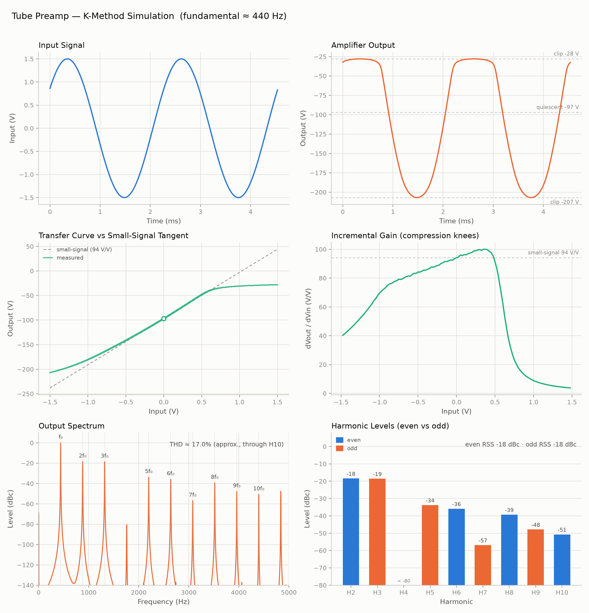

# tube-kmethod-sim

[](https://github.com/jpb-1729/tube-kmethod-sim/actions/workflows/ci.yml)
[](LICENSE)

A C++ simulation of a two-stage vacuum tube preamplifier circuit using the
**K-method**, a discrete-time state-space technique for simulating nonlinear
analog circuits sample-by-sample. Tube behavior is modeled with the
Koren tube equations, and the resulting nonlinear system is solved at each
sample with a damped Newton-Raphson iteration.

A 440 Hz sine driven into clipping: the zoomed input/output waveforms with
clip and quiescent levels marked, the input–output transfer curve against its
small-signal tangent, the incremental gain (compression knees), and the output
spectrum with harmonics annotated plus an even/odd harmonic breakdown.

<picture>
  <source media="(prefers-color-scheme: dark)" srcset="assets/example_output_dark.png">
  
</picture>

## How it works

- The linear part of the circuit (resistors, the cathode bypass cap) is
  expressed as a discrete-time state-space system derived via the bilinear
  transform.
- The two tubes contribute nonlinear grid and anode currents (Koren model)
  that couple back into the circuit's node voltages.
- At every sample, a 4x4 nonlinear system for the tube node voltages is
  solved with Newton's method (finite-difference Jacobian, adaptive damping,
  LU decomposition with a pseudo-inverse fallback for ill-conditioned steps).
- Before processing starts, the same solver is run against the steady-state
  (`dx/dt = 0`) form of the system to find the quiescent DC operating point,
  and the simulation is initialized there. This removes the cold-start
  transient outright; the remaining settling is the physical bias shift as
  the cathode bypass cap charges to its new signal-driven average, which the
  output trim discards based on the state matrix's time constant.
- `main()` builds a 440 Hz test tone, runs it through the amplifier, and
  writes the input/output waveforms to `results.csv`.

## Requirements

- CMake >= 3.16
- A C++17 compiler (GCC or Clang tested)
- [Eigen3](https://eigen.tuxfamily.org/) (>= 3.3), discoverable via
  `find_package(Eigen3)` (e.g. `brew install eigen` on macOS)
- Python 3 with the packages in `requirements.txt`, only needed for plotting
  results

## Building and running

```bash
mkdir build && cd build
cmake ..
cmake --build . --config Release
./SimpleTubeSim
```

This prints input/output RMS levels and writes `results.csv` (columns:
`time,input,output`) to the working directory.

## Plotting results

```bash
pip install -r requirements.txt
python3 plot_results.py
```

Reads `results.csv` and renders a six-panel diagnostic figure — input/output
waveforms zoomed to a couple of cycles (with quiescent and clip levels
marked), the input–output transfer curve against its small-signal tangent,
the incremental gain curve, and the output spectrum with harmonics labeled,
an estimated THD, and an even/odd harmonic-level breakdown — saved to
`results.png`. A numeric summary (operating point, gain, clip levels, THD,
even/odd split) is also printed to the console. Pass `--theme dark`, `--csv`,
`--out`, or `--fmax` to customize; run with `--help` for all options.

## Configuration

Amplifier parameters live in `TubeAmpConfig` in `main.cpp`: circuit values
(plate/grid/cathode resistors, cathode bypass cap), gain, bias voltage,
sample rate, and Newton solver tolerance/iteration limits. Tube presets
(`12AX7`, `12AU7`, `12AT7`) use Norman Koren's published parameter fits
(mu, Ex, Kg1, Kp, Kvb) and are defined in `TUBE_PRESETS`; they can be
assigned to `tube1_params` / `tube2_params`.

## License

MIT — see [LICENSE](LICENSE).
